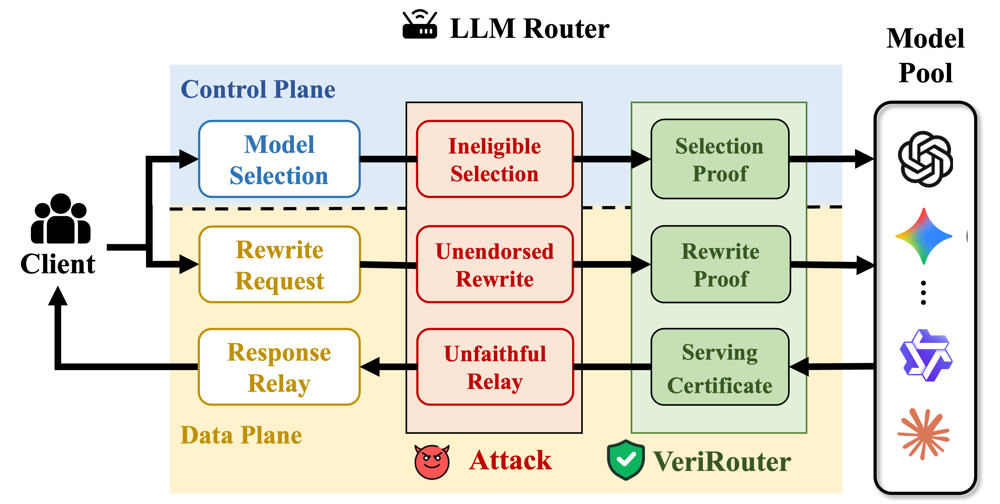

# VeriRouter: Towards Verifiable LLM Routing



VeriRouter is a verifiable LLM routing framework. Its certificate chain verifies:

1. **Model-selection correctness** (control plane): a zero-knowledge proof that the selected model follows the semantic-search relation over a committed reference index.
2. **Rewrite correctness** (data plane): a zero-knowledge proof that the request received by the model was derived from the client request by an endorsed rewrite.
3. **Serving accountability**: a signed certificate binding the request ID, selected model, model request, and response to the provider's registered key.

## Layout

```text
control-plane/zkroute/     Model-selection proof (Python input preparation, Rust prover)
data-plane/zkrewrite/      Rewrite proof
data-plane/signature/      Serving certificate
examples/                  Demo inputs
verirouter.py              Command-line interface (demo, experiment, chain, signature)
```

## Setup

Requires Python 3.12 and Rust nightly.

```bash
sudo apt-get install -y python3 python3-venv openssl libssl-dev pkg-config build-essential
rustup toolchain install nightly
python3.12 -m venv .venv && . .venv/bin/activate
pip install -r requirements.txt
```

## Demo

The demos run offline on the inputs in `examples/`.

```bash
python3 verirouter.py demo --out-dir out/component_demo
```

This proves and verifies model selection and rewrite, signs and checks the serving certificate, and writes `out/component_demo/chain_manifest.json` with `"accept": true`.

Two multi-turn settings are also included: a fresh model-selection proof every turn, or a model pinned after the first verified turn.

```bash
python3 verirouter.py demo --setting-bin examples/e2e_route_each_turn.bin --out-dir out/e2e_demo
python3 verirouter.py demo --setting-bin examples/e2e_session_pinned.bin --out-dir out/e2e_demo
```

## Custom Route Inputs

Route inputs are built from public datasets:
[arena_battles_embeddings](https://huggingface.co/datasets/routellm/arena_battles_embeddings) (graph),
[arena-human-preference-55k](https://huggingface.co/datasets/lmarena-ai/arena-human-preference-55k) (labels), and
[mmlu_battles_embeddings](https://huggingface.co/datasets/routellm/mmlu_battles_embeddings) (queries).
Place them in one directory as `train-00000-of-00001-embedding.parquet`, `train-00000-of-00001-embedding.id.csv`, `train-00000-of-00001-test.parquet`, and `train.csv`.

```bash
mkdir -p out && printf "42\n" > out/queries.txt
python3 verirouter.py experiment \
  --raw-data-dir /path/to/raw_data --n-train 50000 \
  --query-indices-file out/queries.txt \
  --node-count-cap 512 --score-node-count-cap 512 --visit-len-cap 2048 \
  --trace-source replay --skip-real-search-comparison --prepare-only \
  --route-bin-dir out/route_512 --out out/route_512/prepare_report.json

python3 verirouter.py demo \
  --route-input-bin out/route_512/route_input_query_42.bin \
  --out-dir out/demo_512
```

Without `--prepare-only`, `experiment` also benchmarks the route proofs. Run `python3 verirouter.py <command> --help` for all options.
